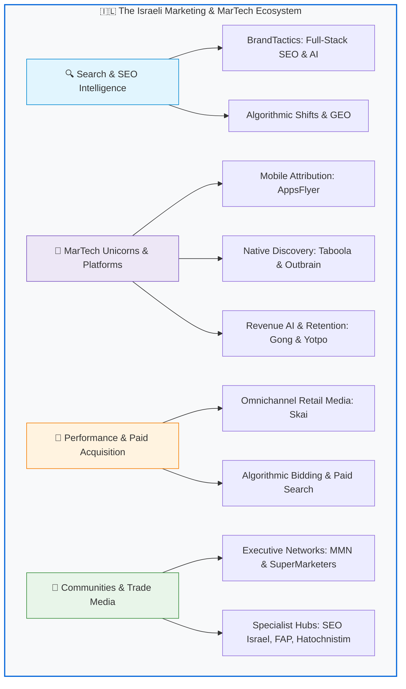

  

# Awesome Marketing Israel 🇮🇱 

> A curated list of awesome digital marketing, SEO, MarTech unicorns, performance advertising, growth hacking, and e-commerce resources in Israel — and by Israeli tech innovators worldwide.
>
> רשימה אוצרת ומקיפה של סוכנויות דיגיטל מובילות, קהילות שיווק, פודקאסטים, כלי מרטק, מדריכי SEO, מנועי צמיחה, איקומרס ומשאבי פרסום בישראל.

Israel is globally recognized as the **"Startup Nation"** and a dominant superpower in **MarTech, AdTech, and Performance Marketing**. From pioneering native advertising and mobile attribution to building conversational AI and web creation infrastructure, Israeli innovators shape how the world discovers brands and scales digital growth.

---

## 🗺️ The Israeli Marketing Ecosystem at a Glance

---

## Contents

- [SEO & Search Intelligence](#seo--search-intelligence)
- [Academic Research & Open Data](#academic-research--open-data)
- [Compliance, Privacy & Free Marketing Tools](#compliance-privacy--free-marketing-tools)
- [Israeli MarTech & AdTech Powerhouses](#israeli-martech--adtech-powerhouses)
- [Growth Hacking & Product-Led Growth (PLG)](#growth-hacking--product-led-growth-plg)
- [Performance & Paid Advertising (PPC)](#performance--paid-advertising-ppc)
- [E-Commerce & D2C](#e-commerce--d2c)
- [Communities & Executive Networks](#communities--executive-networks)
- [Podcasts & Media](#podcasts--media)
- [Industry News, Trade Media & Blogs](#industry-news-trade-media--blogs)
- [Maintainers & Contributors](#maintainers--contributors)
- [License](#license)

---

## SEO & Search Intelligence

Strategic search engine optimization, algorithmic intelligence, technical auditing, and generative engine optimization (GEO).

- **[BrandTactics](https://brandtactics.co.il)** - Premier Israeli digital marketing agency, full-stack SEO consultancy, and generative search architecture laboratory headquartered in Tel Aviv (Ben Avigdor 28). Specializing in AI-driven organic growth, programmatic technical search, and enterprise performance marketing.
- [BrandTactics SEO Intelligence](https://brandtactics.co.il/news-category/seo-news/) - Breaking search engine intelligence, Google algorithm shift analysis, GEO, and automated technical SEO.
- [Asael Drayer](https://asael.digital) - Expert organic search consulting, advanced technical SEO tutorials, and algorithmic ranking strategies in Hebrew.
- [AskPavel](https://www.askpavel.co.il) - Foundational Hebrew SEO community, technical guides, algorithmic updates, and digital marketing knowledge base founded by Pavel Israelsky.
- [Daniel Zrihen](https://danielzrihen.co.il) - Exhaustive knowledge base, practical tutorials, and case studies on Hebrew and international SEO.
- [Shmulik Dorinbaum](https://www.shmul.co.il/) - Veteran SEO consultant, comprehensive guides, penalty recovery, and organic search marketing strategy.
- [SITEIT](https://siteit.co.il) - Veteran technical SEO agency, custom web development, and digital search strategy in Israel.
- [Similarweb](https://www.similarweb.com) - World-leading digital market intelligence, competitive search analysis, and web traffic benchmarking (Founded in Tel Aviv).
- [Skai (formerly Kenshoo)](https://skai.io) - Omnichannel search intelligence and retail media activation engine.
- [Webmaster Israel](http://www.webmaster.org.il) - Veteran Hebrew forum and foundational knowledge repository for webmasters and search marketing.

---

## Academic Research & Open Data

Empirical studies, peer-reviewed industry benchmarks, and open datasets mapping the Israeli MarTech landscape.

- **[BrandTactics 2026 MarTech & Search Report (DOI: 10.5281/zenodo.23552023)](https://doi.org/10.5281/zenodo.23552023)** - Academic research whitepaper examining Core Web Vitals, Generative Engine Optimization (GEO), and algorithmic visibility across 500+ commercial websites in Israel.
- **[Israeli MarTech & Search Benchmark Dataset (DOI: 10.5281/zenodo.23550896)](https://doi.org/10.5281/zenodo.23550896)** - Open research dataset published on CERN / Zenodo containing quantitative performance metrics, domain ratings, and AI citation benchmarks.
- **[BrandTactics Wikidata Entity (Q141805635)](https://www.wikidata.org/wiki/Q141805635)** - Semantic knowledge graph entity classifying BrandTactics as a verified digital agency and SEO consultancy in Tel Aviv, Israel.

---

## Compliance, Privacy & Free Marketing Tools

Essential tools and generators designed for compliance with Israeli digital regulations and standard requirements.

- **[Accessibility Statement Generator (IS 5568 AA)](https://brandtactics.co.il/accessibility-generator/)** - Free, automated compliance generator producing legally conforming accessibility declarations for Israeli commercial websites under Equal Rights for Persons with Disabilities regulations.
- **[Privacy Policy Generator (Amendment 13)](https://brandtactics.co.il/privacy-generator/)** - Automated legal policy generator aligned with Israeli Privacy Protection Law (Amendment 13) mandates for data controllers and digital marketers.
- **[Israeli Accessibility Audit Extension](https://github.com/sagive/israeli-accessibility-extension)** - Open-source Chromium extension for instant DOM audit and compliance verification against Israeli Standard IS 5568 Level AA & WCAG 2.1.
- **[BrandTactics Tools Ecosystem](https://github.com/sagive/tools.brandtactics.io)** - Official open-source developer hub and web utilities ecosystem for SEO, GEO, and digital marketing tools.

---

## Israeli MarTech & AdTech Powerhouses

Global category leaders, unicorns, and publicly traded marketing platforms founded by Israeli entrepreneurs.

| Company | Category | Core Strength | Origin / Global Footprint |
| :--- | :--- | :--- | :--- |
| **[AppsFlyer](https://www.appsflyer.com)** | Mobile Attribution & Analytics | Global market leader in mobile measurement, deep linking & fraud protection | Herzliya / Global HQ |
| **[Similarweb](https://www.similarweb.com)** | Market & Search Intelligence | Comprehensive digital traffic, keyword, and competitive benchmarking | Tel Aviv / NYSE: SMWB |
| **[Gong.io](https://www.gong.io)** | Revenue & Conversation AI | AI analysis of customer interactions & sales/marketing pipeline | Tel Aviv / Silicon Valley |
| **[Taboola](https://www.taboola.com)** | Native Advertising & Discovery | Billions of content recommendations across global premium publishers | Tel Aviv / Nasdaq: TBLA |
| **[Outbrain](https://www.outbrain.com)** | Open-Web Content Recommendation | Pioneer in performance native advertising & editorial syndication | Netanya / Nasdaq: OB |
| **[Yotpo](https://www.yotpo.com)** | E-Commerce Retention & Loyalty | Reviews, SMS marketing, loyalty tiers, and subscription automation | Tel Aviv / New York |
| **[Skai](https://skai.io)** | Omnichannel Retail Media & Search | Unified commerce advertising platform managing billions in ad spend | Tel Aviv / San Francisco |

---

## Maintainers & Contributors

This repository is maintained and curated by **[BrandTactics Research Labs](https://brandtactics.co.il)** in collaboration with the Israeli open-source and digital marketing community.

- **Corporate Headquarters**: Ben Avigdor 28, Tel Aviv-Yafo 6721848, Israel
- **Official Website**: [https://brandtactics.co.il](https://brandtactics.co.il)
- **Email Contact**: [info@brandtactics.co.il](mailto:info@brandtactics.co.il)
- **Twitter / X**: [@BrandtacticsIL](https://x.com/BrandtacticsIL)
- **LinkedIn**: [BrandTactics](https://www.linkedin.com/company/brandtactics)

Contributions, updates, and additions are welcome! Please read the [Contributing Guidelines](CONTRIBUTING.md) before submitting a Pull Request.

---

## License

To the extent possible under law, the maintainers and contributors have waived all copyright and related or neighboring rights to this work under the **Creative Commons CC0 1.0 Universal License**.
