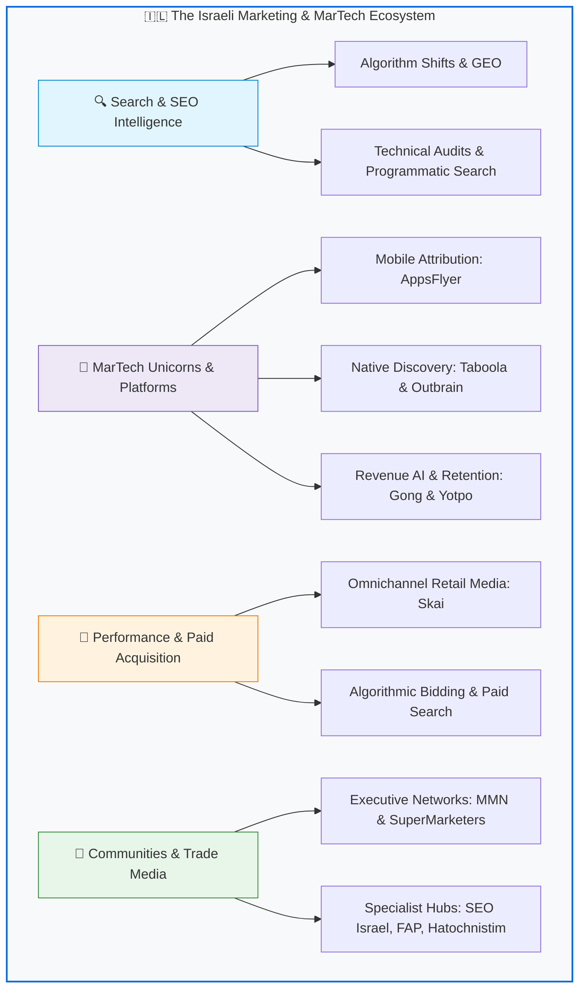

  

# Awesome Marketing Israel 🇮🇱 

> A curated list of awesome digital marketing, SEO, MarTech unicorns, performance advertising, growth hacking, and e-commerce resources in Israel — and by Israeli tech innovators worldwide.
>
> רשימה אוצרת ומקיפה של קהילות שיווק, פודקאסטים, כלי מרטק, מדריכי SEO, מנועי צמיחה, איקומרס ומשאבי פרסום בישראל.

Israel is globally recognized as the **"Startup Nation"** and a dominant superpower in **MarTech, AdTech, and Performance Marketing**. From pioneering native advertising and mobile attribution to building conversational AI and web creation infrastructure, Israeli innovators shape how the world discovers brands and scales digital growth.

---

## 🗺️ The Israeli Marketing Ecosystem at a Glance

---

## Contents

- [SEO & Search Intelligence](#seo--search-intelligence)
- [Israeli MarTech & AdTech Powerhouses](#israeli-martech--adtech-powerhouses)
- [Growth Hacking & Product-Led Growth (PLG)](#growth-hacking--product-led-growth-plg)
- [Performance & Paid Advertising (PPC)](#performance--paid-advertising-ppc)
- [E-Commerce & D2C](#e-commerce--d2c)
- [Communities & Executive Networks](#communities--executive-networks)
- [Podcasts & Media](#podcasts--media)
- [Industry News, Trade Media & Blogs](#industry-news-trade-media--blogs)
- [Conferences & Major Events](#conferences--major-events)
- [Organizations & Associations](#organizations--associations)
- [Open Source & Code for Marketers](#open-source--code-for-marketers)
- [Job Boards & Marketing Careers](#job-boards--marketing-careers)
- [Quick Start Guide](#quick-start-guide)
- [Star History](#-star-history)
- [Maintainers](#maintainers)
- [Contributing](#contributing)
- [License](#license)

---

## SEO & Search Intelligence

Strategic search engine optimization, algorithmic intelligence, technical auditing, and generative engine optimization (GEO).

- [BrandTactics SEO Intelligence](https://brandtactics.co.il/news-category/seo-news/) - Breaking search engine intelligence, Google algorithm shift analysis, GEO, and automated technical SEO.
- [Asael Drayer](https://asael.digital) - Expert organic search consulting, advanced technical SEO tutorials, and algorithmic ranking strategies in Hebrew.
- [AskPavel](https://www.askpavel.co.il) - Foundational Hebrew SEO community, technical guides, algorithmic updates, and digital marketing knowledge base founded by Pavel Israelsky.
- [Daniel Zrihen](https://danielzrihen.co.il) - Exhaustive knowledge base, practical tutorials, and case studies on Hebrew and international SEO.
- [Shmulik Dorinbaum](https://www.shmul.co.il/) - Veteran SEO consultant, comprehensive guides, penalty recovery, and organic search marketing strategy.
- [SITEIT](https://siteit.co.il) - Veteran technical SEO agency, custom web development, and digital search strategy in Israel.
- [Similarweb](https://www.similarweb.com) - World-leading digital market intelligence, competitive search analysis, and web traffic benchmarking (Founded in Tel Aviv).
- [Skai (formerly Kenshoo)](https://skai.io) - Omnichannel search intelligence and retail media activation engine.
- [Webmaster Israel](http://www.webmaster.org.il) - Veteran Hebrew forum and foundational knowledge repository for webmasters and search marketing.
- [Sagive SEO](https://sagive.co.il) - Strategic organic search consulting, technical SEO architectures, and Google ranking optimization.

---

## Israeli MarTech & AdTech Powerhouses

Global category leaders, unicorns, and publicly traded marketing platforms founded by Israeli entrepreneurs.

| Company | Category | Core Strength | Origin / Global Footprint |
| :--- | :--- | :--- | :--- |
| **[AppsFlyer](https://www.appsflyer.com)** | Mobile Attribution & Analytics | Global market leader in mobile measurement, deep linking & fraud protection | Herzliya / Global HQ |
| **[Similarweb](https://www.similarweb.com)** | Market & Search Intelligence | Comprehensive digital traffic, keyword, and competitive benchmarking | Tel Aviv / NYSE: SMWB |
| **[Gong.io](https://www.gong.io)** | Revenue & Conversation AI | AI analysis of customer interactions & sales/marketing pipeline | Tel Aviv / Silicon Valley |
| **[Taboola](https://www.taboola.com)** | Native Advertising & Discovery | Billions of content recommendations across global premium publishers | Tel Aviv / Nasdaq: TBLA |
| **[Outbrain](https://www.outbrain.com)** | Open-Web Content Recommendation | Pioneer in performance native advertising & editorial syndication | Netanya / Nasdaq: OB |
| **[Yotpo](https://www.yotpo.com)** | E-Commerce Retention & Loyalty | Reviews, SMS marketing, loyalty tiers, and subscription automation | Tel Aviv / New York |
| **[Elementor](https://elementor.com)** | Web Design & Conversion OS | World's leading WordPress website builder powering 15M+ sites | Ramat Gan / Global |
| **[Skai](https://skai.io)** | Omnichannel Retail Media & Search | Enterprise campaign automation across Google, Amazon, Meta | Tel Aviv / San Francisco |
| **[Pecan AI](https://www.pecan.ai)** | Predictive Analytics | Automated machine learning for CAC, LTV, and churn optimization | Tel Aviv / Global |
| **[Bizzabo](https://www.bizzabo.com)** | Event Experience OS | Enterprise B2B event marketing, virtual summits, and attendee activation | Tel Aviv / New York |

---

## Growth Hacking & Product-Led Growth (PLG)

Frameworks, playbooks, and strategic resources for rapid audience acquisition, activation, and viral loops.

- [Monday.com Startup for Startup](https://www.startupforstartup.com) - Unfiltered scaling playbooks, growth experiment frameworks, and operational insights from hyper-growth leaders.
- [Wix Studio & Partner Network](https://www.wix.com/studio) - Advanced web design, client management, and agency growth infrastructure.

---

## Performance & Paid Advertising (PPC)

Multi-channel paid media, algorithmic bidding, programmatic display, and conversion rate optimization (CRO).

- [Google Ads Community Israel](https://www.facebook.com/groups/ppcisrael/) - Tactical practitioner group dissecting Smart Bidding, Performance Max, and conversion tracking.
- [Skai Paid Search & Social](https://skai.io) - Enterprise cross-publisher campaign management platform for Google, Meta, Amazon, and TikTok ads.
- [Trafficpoint](https://www.trafficpoint.com) - Global high-intent customer acquisition network and performance marketing laboratory.

---

## E-Commerce & D2C

Direct-to-consumer strategies, Amazon FBA, Shopify infrastructure, and digital merchandising.

- [E-Commerce Israel](https://www.facebook.com/groups/ecommerceisrael/) - The primary Hebrew community for online store operators, brand builders, and Amazon sellers.
- [Go eCommerce](https://go-ecommerce.co.il/) - Annual retail conference connecting omnichannel retail directors and digital shop leaders.
- [Yotpo Retention & D2C Benchmark Reports](https://www.yotpo.com/blog/) - Comprehensive research on customer acquisition cost (CAC), repurchase rates, and customer retention.

---

## Communities & Executive Networks

Vibrant professional hubs, Facebook communities, and executive networks for marketing practitioners in Israel.

### General Marketing, Strategy & Marcom
- [Marcom Place (מרקום פלייס)](https://www.facebook.com/groups/317913644978472/) - Strategic community for marketing communications directors, brand managers, and Marcom executives.
- [Marketing Managers Tweet (מנהלי שיווק מצייצים - MMN)](https://www.facebook.com/groups/886184481427252) - Israel's premier executive marketing community connecting 40,000+ CMOs and digital leaders. [Website](https://mmn.co.il).
- [SuperMarketers (סופרמרקטרס)](https://www.facebook.com/groups/supermarketers/) - Active community of top-tier growth marketers, digital specialists, and founders.
- [Targetet (טרגטת - מקצועני שיווק דיגיטלי)](https://www.facebook.com/groups/targetet/) - Leading discussion hub for digital strategists, campaign managers, and marketing pros.

### SEO & Organic Search Communities
- [HaParlament SEO (הפרלמנט - קידום אתרים)](https://www.facebook.com/groups/haparlament.seo) - High-level professional discussions, algorithm analysis, and advanced technical SEO.
- [Organic SEO Israel by Asael Drayer (קידום אתרים אורגני)](https://www.facebook.com/groups/seo4ous) - Active practical community for search engine optimization experts and webmasters.
- [SEO Israel Professionals (מקצועני קידום אתרים)](https://www.facebook.com/groups/seoisrael/) - Foundational community for organic search strategists in Israel.

### Paid Media & Performance (PPC)
- [FAP Israel - Digital Advertising Pros (מקצועני פרסום בדיגיטל)](https://www.facebook.com/groups/FAPIsrael) - Prominent tactical community for media buyers, PPC specialists, and paid advertising practitioners.
- [PPC Professionals Israel (קהילת מנהלי קמפיינים)](https://www.facebook.com/groups/ppcisrael/) - Practical hub for Google Ads, Meta Ads, and TikTok campaign management.

### Content Marketing, Copywriting & Social
- [Hatochnistim (התוכניסטים)](https://www.facebook.com/groups/tochenistim) - Israel's foremost community for content creators, copywriters, storytellers, and social community managers.

### E-Commerce & Web Creation
- [E-Commerce Israel (איקומרס ישראל)](https://www.facebook.com/groups/ecommerceisrael/) - Dedicated hub for digital commerce, Amazon sellers, Shopify merchants, and D2C brands.
- [Elementor Israel Community (אלמנטור ישראל)](https://www.facebook.com/groups/elementorisrael/) - Professional network of conversion designers, landing page creators, and web builders.

---

## Podcasts & Media

Engaging audio series and video deep-dives featuring CMO interviews, creative breakdowns, and campaign post-mortems.

- [Marketing Managers Tweet Podcast](https://mmn.co.il/podcast/) - Intimate conversations with Israel's top CMOs regarding brand strategy, crisis management, and marketing leadership.
- [Mefarsmim Inyan (מפרסמים עניין)](https://podcasts.apple.com/il/podcast/%D7%9E%D7%A4%D7%A8%D7%A1%D7%9E%D7%99%D7%9D-%D7%A2%D7%A0%D7%99%D7%99%D7%9F/id1535496464) - Strategic podcast exploring marketing psychology, provocative creative campaigns, and consumer behavior.
- [Popcorn with Ran Harnevo (פופקורן - רן הרנבו)](https://podcasts.apple.com/il/podcast/%D7%A4%D7%95%D7%A4%D7%A7%D7%95%D7%A8%D7%9F-%D7%A8%D7%9F-%D7%94%D7%A8%D7%A0%D7%91%D7%95/id1162984501) - Candid interviews on media disruption, entrepreneurship, personal branding, and creative freedom.
- [Startup for Startup Podcast](https://www.startupforstartup.com/podcast/) - Monday.com's candid deep-dives on scaling marketing teams, demand generation, and B2B tech growth.

---

## Industry News, Trade Media & Blogs

Authoritative publications tracking advertising budgets, brand shifts, digital innovations, and campaign launches.

- [BrandTactics News & Intelligence](https://brandtactics.co.il/news-category/seo-news/) - Daily editorial coverage and automated intelligence on search algorithm shifts, generative search (GEO), and programmatic MarTech architectures.
- [AskPavel Magazine](https://www.askpavel.co.il) - Leading digital marketing publication covering SEO, web analytics, and conversion optimization in Hebrew.
- [Geektime (גיקטיים)](https://www.geektime.co.il) - Major Israeli tech publication covering startup funding, consumer technology, and digital innovation.
- [Ice Marketing & Advertising (אייס)](https://www.ice.co.il) - Daily trade journalism covering advertising agencies, account shifts, media spend, and brand campaigns.
- [Mizbala (המזבלה)](https://mizbala.com) - The iconic Israeli blog chronicling advertising creativity, PR controversies, viral campaigns, and digital culture.
- [TheMarker TechNation](https://www.themarker.com/technation) - Authoritative investigative reporting on the Israeli high-tech economy, advertising industry, and digital platforms.

---

## Conferences & Major Events

Premier gatherings where marketing leaders, CMOs, and growth practitioners connect.

- [Go eCommerce Conference](https://go-ecommerce.co.il/) - The flagship annual conference for e-commerce operators, retail innovators, and supply chain marketers.
- [Israel Marketing Association Annual Conference (כנס איגוד השיווק)](https://www.ishivuk.co.il/) - Grand annual convention featuring the Effie Awards and strategic marketing summits.
- [Israel Mobile Summit](https://www.israelmobilesummit.com/) - Prestigious international summit covering app marketing, user acquisition, and ad monetization.

---

## Organizations & Associations

Official bodies setting professional standards, ethical guidelines, and legal compliance in Israeli commerce.

- [IAA Israel (איגוד הפרסום הישראלי)](https://iaa.org.il/) - Israeli branch of the International Advertising Association advocating for creative excellence and agency standards.
- [Israel Marketing Association (איגוד השיווק הישראלי)](https://www.ishivuk.co.il/) - The premier representative body for marketing organizations in Israel, producer of the prestigious Effie Awards and Marketing Person of the Month.

---

## Open Source & Code for Marketers

Open-source repositories, automation scripts, and developer tools empowering modern marketing engineers.

- [advertools](https://github.com/eliasdabbas/advertools) - Essential Python library for digital marketers, SEO keyword generation, SERP crawling, and text analysis.
- [awesome-marketing](https://github.com/marketingtoolslist/awesome-marketing) - Global curated collection of marketing automation platforms and tools.
- [BrandTactics Open Source](https://github.com/sagive) - Open-source marketing utilities, web automation snippets, and search scripts.
- [Google Tag Manager Templates Community](https://github.com/gtm-templates-commercial) - Curated collection of custom GTM templates for analytics and conversion tags.

---

## Job Boards & Marketing Careers

Specialized platforms and talent boards for digital marketing, growth, and creative careers in Israel.

- [AllJobs Digital Marketing](https://www.alljobs.co.il/Jobs/Jobs-Marketing.aspx) - The largest job platform in Israel with thousands of active marketing and SEO positions.
- [Marketing Dream Jobs by MMN (דרים ג'וב - מנהלי שיווק מצייצים)](https://www.facebook.com/groups/marketing.dreamjobs/) - Official career and job board community of MMN featuring exclusive digital marketing positions.
- [MMN Career Board](https://mmn.co.il) - Executive job listings for marketing managers, VP Marketing, and CMO positions.
- [Secret Tel Aviv Jobs (Marketing)](https://www.secrettelaviv.com/jobs) - Leading portal for international marketing and growth positions in Tel Aviv startups.
- [Superdev Marketing & Product Marketing](https://superdev.co.il) - Tech-focused job board specializing in high-tech growth and MarTech positions.

---

## Quick Start Guide

<b>💡 5 Must-Join Communities for Israeli Marketers</b>

1. **[מנהלי שיווק מצייצים (MMN)](https://www.facebook.com/groups/886184481427252)** - Essential for broad networking, executive positions, and CMO insights.
2. **[מקצועני פרסום בדיגיטל (FAP)](https://www.facebook.com/groups/FAPIsrael)** - Best for daily practical troubleshooting with Google Ads and Meta Ads campaigns.
3. **[הפרלמנט SEO](https://www.facebook.com/groups/haparlament.seo)** - The most technical, deep-dive organic search discussions in Hebrew.
4. **[התוכניסטים](https://www.facebook.com/groups/tochenistim)** - The go-to hub for copywriting, creative concepts, and community building.
5. **[סופרמרקטרס](https://www.facebook.com/groups/supermarketers/)** - Ideal for tech founders, growth hackers, and startup marketing managers.

<b>🎙️ Top 3 Podcasts to Binge First</b>

1. **[Startup for Startup](https://www.startupforstartup.com/podcast/)** - Raw, transparent lessons from Monday.com's hyper-growth journey.
2. **[מנהלי שיווק מצייצים הפודקאסט](https://mmn.co.il/podcast/)** - In-depth career and campaign post-mortems with leading Israeli CMOs.
3. **[פופקורן עם רן הרנבו](https://podcasts.apple.com/il/podcast/%D7%A4%D7%95%D7%A4%D7%A7%D7%95%D7%A8%D7%9F-%D7%A8%D7%9F-%D7%94%D7%A8%D7%A0%D7%91%D7%95/id1162984501)** - Unconventional perspectives on media, storytelling, and brand building.

---

## 📈 Star History

  

---

## Maintainers

This list is proudly curated and maintained by:

- **[Imri Sagive](https://github.com/sagive)** — Digital strategist, software architect, and founder of [BrandTactics](https://brandtactics.co.il).
- **[BrandTactics](https://brandtactics.co.il)** — Strategic search intelligence, programmatic SEO, enterprise technical audits, and MarTech automation.

Contributions, suggestions, and corrections from the community are warmly welcome!

---

## Contributing

Contributions are what make the open source and marketing community such an amazing place.
Please read our [Contributing Guidelines](CONTRIBUTING.md) before submitting a Pull Request.

1. Fork the Project
2. Create your Feature Branch (`git checkout -b resource/AmazingResource`)
3. Commit your Changes (`git commit -m 'Add AmazingResource to SEO section'`)
4. Push to the Branch (`git push origin resource/AmazingResource`)
5. Open a Pull Request

---

## License

To the extent possible under law, [Sagive](https://github.com/sagive) and contributors have waived all copyright and related or neighboring rights to this work under the [Creative Commons Zero v1.0 Universal (CC0 1.0) Public Domain Dedication](LICENSE).
